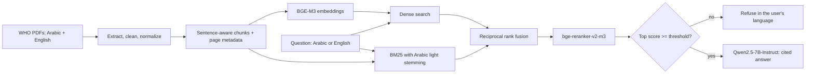

# Bilingual (Arabic/English) RAG Assistant

Ask questions in **Arabic or English** about WHO documents and get **cited answers** in the language you asked in.
Built to work for any Arabic-speaking region, not one country.


- **Live demo:** https://huggingface.co/spaces/Wadudansari/bilingual-doc-assistant *(free ZeroGPU Space; may be asleep or out of quota, see the demo video)*
- **Colab notebook:** [Open in Colab](https://colab.research.google.com/drive/1ItqRAoP8JbMDJpFnEd0yq2O-eAPuwZ1Y?usp=sharing)

## What it does

- Finds the right passage even when the **question and the document are in different languages** (cross-lingual retrieval).
- Combines **dense + keyword (BM25) search**, then **reranks** with a cross-encoder.
- Answers **only from the retrieved text**, cites passage numbers, and **refuses** when the documents don't contain the answer, without calling the LLM.
- Handles Arabic specifics: diacritics, alef variants, PDF presentation forms, and prefix stripping for keyword search.

## Example

| | |
|---|---|
| **Question (Arabic)** | ما هي الأهداف الاستراتيجية لخطة العمل العالمية؟ |
| **Answer (Arabic)** | Lists the five strategic objectives, e.g. تحسين الوعي وفهم ظاهرة مقاومة مضادات الميكروبات, with source citations |
| **Question (English)** | What are the five strategic objectives of the global action plan? |
| **Answer (English)** | (1) improve awareness and understanding of antimicrobial resistance; (2) strengthen knowledge through surveillance and research; (3) reduce the incidence of infection; (4) optimize the use of antimicrobial agents; (5) ensure sustainable investment in countering antimicrobial resistance. Source: `amr_en.pdf`, p.8 |
| **Off-topic question** | Who won the 2022 football World Cup? → *"I couldn't find an answer to this in the loaded documents."* (no sources, LLM not called) |

## Architecture



## Data

**Source document:** WHO, *Global action plan on antimicrobial resistance* (2015), published in English and Arabic on [WHO IRIS](https://iris.who.int/handle/10665/193736). The two versions are translations of each other, which makes them a natural test bed for cross-lingual retrieval.

| | English (`amr_en.pdf`) | Arabic (`amr_ar.pdf`) |
|---|---|---|
| Pages | 28 | 28 |
| Pages with no extractable text | 4 | 3 |
| Chunks after cleaning | 118 | 130 |

- **Total index:** 248 chunks, each with source file and page number; embeddings are 1024-dimensional (BGE-M3).
- **Cleaning:** blank and copyright/cataloguing pages are skipped, wrapped lines are joined, link markup is removed, and Arabic text is Unicode-normalized.
- **Chunking:** sentence-aware, up to 800 characters, 1-sentence overlap.
- The PDFs are **not redistributed** in this repository (see [Data and credits](#data-and-credits)).

**Models**

| Role | Model |
|---|---|
| Embeddings | `BAAI/bge-m3` |
| Reranker | `BAAI/bge-reranker-v2-m3` |
| Generator | `Qwen/Qwen2.5-7B-Instruct` (4-bit in Colab; bf16 on the ZeroGPU Space) |
| Keyword search | BM25 (`rank_bm25`) with a light Arabic stemmer |

**Evaluation set (5 questions, each written in English and Arabic, page-level ground truth)**

| Question (English) | Correct page |
|---|---|
| What are the five strategic objectives of the global action plan? | 8 |
| What is the overall goal of the global action plan? | 15 |
| Which World Health Assembly resolution requested the development of the action plan? | 8 |
| What does the global action plan provide a framework for? | 9 |
| Why are incremental targets for implementation needed? | 13 |

A retrieval counts as a hit if any returned chunk comes from a correct page. Each question is tested four ways: English or Arabic question, against all documents or only the other language's document.

## Design decisions (and why)

| Decision | Reason |
|---|---|
| **BGE-M3** multilingual embeddings | One vector space for Arabic and English, so cross-lingual retrieval works without translation. |
| **Sentence-aware chunking**, 1-sentence overlap | Avoids cutting sentences in half; page numbers are kept for citations. |
| **Embed normalized text, display original text** | Better matching without altering what the user reads. |
| **Light Arabic stemming for BM25 only** | Arabic attaches prefixes (ال، و، ب، ل), so raw keyword matching misses inflected forms. |
| **BM25 down-weighted in fusion** | It adds noise in cross-lingual queries (no shared words). |
| **Cross-encoder reranker** | Fixes ordering that dense/hybrid get wrong; its score also drives the refusal gate. |
| **Score threshold before the LLM** | Deterministic, faster, and cheaper than asking the LLM to decide whether to refuse. |

## Results

> Current evaluation set: **5 questions**. Treat every number below as indicative: one question changes a score by 0.20. Extending it to 20+ questions is the first roadmap item.

### Retrieval

Initial run, **before** Arabic stemming was added (5 questions). Hit@k = share of questions with a correct-page chunk in the top k; MRR = mean reciprocal rank.

| Setting | System | Hit@1 | Hit@3 | Hit@5 | MRR |
|---|---|---|---|---|---|
| EN → all docs | dense | 0.80 | 0.80 | 1.00 | 0.84 |
| EN → all docs | hybrid | 0.60 | 1.00 | 1.00 | 0.77 |
| EN → all docs | hybrid + rerank | 0.80 | 1.00 | 1.00 | 0.90 |
| AR → all docs | dense | 0.60 | 0.80 | 1.00 | 0.74 |
| AR → all docs | hybrid | 0.40 | 0.60 | 0.60 | 0.53 |
| AR → all docs | hybrid + rerank | 0.80 | 1.00 | 1.00 | 0.87 |
| EN → Arabic doc | dense | 0.40 | 0.60 | 1.00 | 0.56 |
| EN → Arabic doc | hybrid | 0.20 | 0.60 | 0.80 | 0.44 |
| EN → Arabic doc | hybrid + rerank | 0.60 | 1.00 | 1.00 | 0.77 |
| AR → English doc | dense | 0.80 | 0.80 | 0.80 | 0.83 |
| AR → English doc | hybrid | 0.80 | 0.80 | 0.80 | 0.83 |
| AR → English doc | hybrid + rerank | 0.60 | 1.00 | 1.00 | 0.77 |

What the table shows:

- **Reranking reached Hit@3 = 1.00 in all four settings**, including both cross-lingual ones, so the right page was always in the top 3.
- **Plain hybrid search hurt Arabic.** For Arabic questions over all documents, Hit@5 fell from 1.00 (dense) to 0.60, because keyword matching missed Arabic word forms. This motivated the light stemmer.
- Cross-lingual retrieval works: an English question reached the Arabic passage (EN → Arabic doc) and an Arabic question reached the English one (AR → English doc).

### Refusal gate

The reranker's top score decides whether to answer or refuse (`min_score = 0.30`). If no passage reaches the threshold, the system refuses in the user's language and never calls the LLM.

| Question | Type | Top score | Outcome |
|---|---|---|---|
| What is the overall goal of the global action plan? | on-topic | 1.00 | answered |
| Why are incremental targets for implementation needed? | on-topic | 0.97 | answered |
| ما هو الهدف العام لخطة العمل العالمية؟ | on-topic | 1.00 | answered |
| كيف يمكن خفض معدلات الإصابة بالعدوى؟ | on-topic | 0.88 | answered |
| Who won the 2022 football World Cup? | off-topic | 0.00 | refused |
| ما هو أفضل مضاد حيوي لعلاج الالتهاب الرئوي؟ | off-topic, close to the document's subject | 0.15 | refused |
| Give me a recipe for biryani | off-topic | 0.00 | refused |
| من هو رئيس وزراء بريطانيا؟ | off-topic | 0.00 | refused |

**Result:** 4/4 on-topic questions answered and 4/4 off-topic questions refused. On-topic scores were 0.88–1.00 and off-topic scores 0.00–0.15, a wide margin around the 0.30 cutoff.

**Caveat:** only 8 questions. The threshold needs testing on more near-miss questions (on topic but not answered by the text) before it can be trusted.

## Quickstart

**Easiest: run the [Colab notebook](https://colab.research.google.com/drive/1ItqRAoP8JbMDJpFnEd0yq2O-eAPuwZ1Y?usp=sharing)** on a free T4 GPU (Runtime → Change runtime type → T4 GPU).

Or run the repository locally:

```bash
git clone https://github.com/Wadud-Ansari/bilingual-rag-assistant.git
cd bilingual-rag-assistant
pip install -r requirements.txt

# 1. Put the PDFs in data/ (see data/README.md), then build the index
python -m rag.ingest data/amr_en.pdf data/amr_ar.pdf --out index

# 2. Evaluate retrieval and the refusal threshold
python -m rag.evaluate --index index

# 3. Ask a question (hosted model via HF token, or a local GPU model)
export HF_TOKEN=...            # for --backend api
python -m rag.ask "What are the five strategic objectives?" --backend api
python -m rag.ask "ما هي الأهداف الاستراتيجية لخطة العمل العالمية؟" --backend local
```

A 7B model in 4-bit needs a CUDA GPU (a free Colab T4 works). Embedding and reranking run on CPU, only slowly.

## Repository layout

```
rag/
  text.py       Arabic normalization, light stemmer, tokenizer, language detection
  ingest.py     PDF -> clean text -> chunks -> embeddings (CLI)
  retrieve.py   dense / hybrid (RRF) / reranked retrieval
  generate.py   prompt, refusal gate, local and API generators
  evaluate.py   Hit@k, MRR, refusal accuracy (CLI)
  ask.py        one-question CLI
evaluation/     eval_set.json, refusal_set.json
space/          Hugging Face Space (self-contained app.py for ZeroGPU)
docs/           overview.png
data/           source PDFs (git-ignored)
notebooks/      Colab notebook (also linked above)
```

The Space's `app.py` duplicates the pipeline logic on purpose, because Spaces deploy a single folder.

## Known limitations

- **One document pair** and a **small evaluation set**: results show the approach works, not how well it generalizes.
- **PDF extraction noise** in Arabic (some scrambled numbers and stray characters in the PDF text). Layout-aware extraction (e.g. PyMuPDF or OCR) would help.
- **The stemmer is crude**: it over-trims some words (for example, العالمية becomes عالم). It is applied to both documents and queries, so matching still works, but a proper Arabic analyzer would do better.
- **Citations are coarse**: the 7B model sometimes puts one citation after a whole list instead of one per item.
- **Free-tier demo**: ZeroGPU has shared quota and cold starts.
- **No answer-faithfulness evaluation yet**: only retrieval and refusal are measured.

## Roadmap

- [ ] 20+ evaluation questions across more pages, and re-run retrieval after the stemming fix
- [ ] Near-miss refusal questions (on topic, not in the text) to stress-test the threshold
- [ ] Answer-faithfulness and citation-accuracy checks
- [ ] More documents and Arabic dialect-friendly queries
- [ ] Layout-aware PDF extraction
- [ ] Right-to-left rendering fixes in the chat UI

## Data and credits

Source documents are published by the **World Health Organization** (WHO IRIS). They are not redistributed in this repository; check the licence on each IRIS record (many are CC BY-NC-SA 3.0 IGO) before reuse. The live demo is **non-commercial**. Models: BAAI BGE-M3, BAAI bge-reranker-v2-m3, Alibaba Qwen2.5-7B-Instruct (see their model cards for licences).

Code: MIT, see `LICENSE`.

## Author

**Wadud Ansari** is a licensed Computer Engineer (Nepal Engineering Council, NEC) who builds applied AI systems in machine learning, computer vision and natural language processing.
GitHub: [@Wadud-Ansari](https://github.com/Wadud-Ansari)
