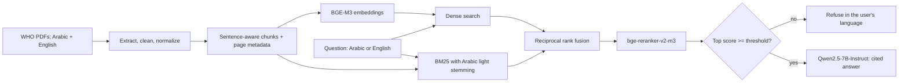

# Bilingual (Arabic/English) RAG Assistant

Ask questions in **Arabic or English** about WHO documents and get **cited answers** in the language you asked in.
Built to work for any Arabic-speaking region, not one country.

- **Live demo:** https://huggingface.co/spaces/Wadudansari/bilingual-doc-assistant *(free ZeroGPU Space; may be asleep or out of quota, see the demo video)*
- **Colab notebook:**(https://colab.research.google.com/drive/1ItqRAoP8JbMDJpFnEd0yq2O-eAPuwZ1Y?usp=sharing)

## What it does

- Finds the right passage even when the **question and the document are in different languages** (cross-lingual retrieval).
- Combines **dense + keyword (BM25) search**, then **reranks** with a cross-encoder.
- Answers **only from the retrieved text**, cites passage numbers, and **refuses** when the documents don't contain the answer, without calling the LLM.
- Handles Arabic specifics: diacritics, alef variants, PDF presentation forms, and prefix stripping for keyword search.

## Architecture



## Design decisions (and why)

| Decision | Reason |
|---|---|
| **BGE-M3** multilingual embeddings | One vector space for Arabic and English, so cross-lingual retrieval works without translation. |
| **Sentence-aware chunking**, 1-sentence overlap | Avoids cutting sentences in half; page numbers are kept for citations. |
| **Embed normalized text, display original text** | Better matching without altering what the user reads. |
| **Light Arabic stemming for BM25 only** | Arabic attaches prefixes (ال، و، ب، ل), so raw keyword matching misses inflected forms. |
| **BM25 down-weighted in fusion** | It adds noise in cross-lingual queries (no shared words). |
| **Cross-encoder reranker** | Fixes ordering that dense/hybrid get wrong; its score also drives the refusal gate. |
| **Score threshold before the LLM** | Deterministic, faster, and cheaper than asking the LLM to decide whether to refuse. |

## Results

> Replace the `TODO` tables with the output of `python -m rag.evaluate --index index`.
> Current evaluation set: **5 questions** (EN + AR, with page-level ground truth), extend it to 20+ before drawing conclusions.

### Retrieval

`TODO: paste table from rag.evaluate (after Arabic stemming fix)`

Early run (5 questions, **before** Arabic stemming), kept for the record:

- Reranking reached **Hit@3 = 1.00** in all four settings (EN→all, AR→all, EN→AR doc, AR→EN doc).
- Plain hybrid search **hurt Arabic**: AR→all Hit@5 fell from 1.00 (dense) to 0.60, because keyword matching missed Arabic word forms. This motivated the light stemmer.

### Refusal gate

`TODO: paste output of rag.evaluate (min_score = 0.30)`

In a first check, on-topic questions scored 0.88–1.00 and off-topic ones 0.00–0.15, so the gap is wide, but the test set is small.

## Quickstart

```bash
git clone https://github.com/Wadud-Ansari/bilingual-rag-assistant.git
cd bilingual-rag-assistant
pip install -r requirements.txt

# 1. Put the PDFs in data/ (see data/README.md), then build the index
python -m rag.ingest data/amr_en.pdf data/amr_ar.pdf --out index

# 2. Evaluate retrieval and the refusal threshold
python -m rag.evaluate --index index

# 3. Ask a question (hosted model via HF token, or a local GPU model)
export HF_TOKEN=...            # for --backend api
python -m rag.ask "What are the five strategic objectives?" --backend api
python -m rag.ask "ما هي الأهداف الاستراتيجية لخطة العمل العالمية؟" --backend local
```

A 7B model in 4-bit needs a CUDA GPU (a free Colab T4 works). Embedding and reranking run on CPU, only slowly.

## Repository layout

```
rag/
  text.py       Arabic normalization, light stemmer, tokenizer, language detection
  ingest.py     PDF -> clean text -> chunks -> embeddings (CLI)
  retrieve.py   dense / hybrid (RRF) / reranked retrieval
  generate.py   prompt, refusal gate, local and API generators
  evaluate.py   Hit@k, MRR, refusal accuracy (CLI)
  ask.py        one-question CLI
evaluation/     eval_set.json, refusal_set.json
space/          Hugging Face Space (self-contained app.py for ZeroGPU)
data/           source PDFs (git-ignored)
notebooks/      Colab notebook
```

The Space's `app.py` duplicates the pipeline logic on purpose, because Spaces deploy a single folder.

## Known limitations

- **One document pair** and a **small evaluation set**: results show the approach works, not how well it generalizes.
- **PDF extraction noise** in Arabic (some scrambled numbers and stray characters in the PDF text). Layout-aware extraction (e.g. PyMuPDF or OCR) would help.
- **The stemmer is crude**: it over-trims some words. It is applied to both documents and queries, so matching still works, but a proper Arabic analyzer would do better.
- **Citations are coarse**: the 7B model sometimes puts one citation after a whole list instead of one per item.
- **Free-tier demo**: ZeroGPU has shared quota and cold starts.
- **No answer-faithfulness evaluation yet**: only retrieval and refusal are measured.

## Roadmap

- [ ] 20+ evaluation questions across more pages
- [ ] Answer-faithfulness and citation-accuracy checks
- [ ] More documents and Arabic dialect-friendly queries
- [ ] Layout-aware PDF extraction
- [ ] Right-to-left rendering fixes in the chat UI

## Data and credits

Source documents are published by the **World Health Organization** (WHO IRIS). They are not redistributed in this repository; check the licence on each IRIS record (many are CC BY-NC-SA 3.0 IGO) before reuse. The live demo is **non-commercial**. Models: BAAI BGE-M3, BAAI bge-reranker-v2-m3, Alibaba Qwen2.5-7B-Instruct (see their model cards for licences).

Code: MIT, see `LICENSE`.

## Author

Wadud Ansari, Computer Engineering graduate focused on AI/ML and computer vision.
GitHub: [@Wadud-Ansari](https://github.com/Wadud-Ansari)
